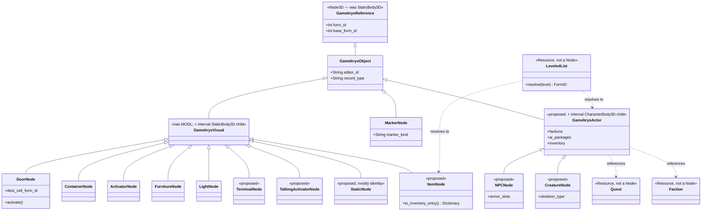

# New Vegas Data Model — Class Hierarchy Design Notes

Companion to `nv_data_model_reference.html` (the field-level GECK reference). This document is
angled the other way: given the record types and their shared/divergent fields, what class
hierarchy should this codebase actually build? Grounded in what's real today
(`project/gamebryo/*.gd`), not a clean-slate proposal — every class below is either already real, or
marked `proposed` as an extension of that real chain.

## The chain that already exists — and one change to it

```
Node3D                                          ← was StaticBody3D; see below
  └─ GamebryoReference        (form_id, base_form_id — every REFR has this much)
       └─ GamebryoObject      (editor_id, record_type — base records with an OBND)
            ├─ MarkerNode     (marker_kind — no mesh, no collision, CK-only helpers)
            └─ GamebryoVisual (MeshInstance3D children — has MODL)
                 │              + an internal StaticBody3D CHILD node when it needs
                 │                collision, not by inheriting one — see below
                 ├─ DoorNode       (dest_cell_form_id, dest_position/rotation, activate())
                 ├─ ContainerNode  (identity subclass only — no added fields yet)
                 ├─ ActivatorNode  (identity subclass only — no added fields yet)
                 ├─ FurnitureNode  (identity subclass only — no added fields yet)
                 └─ LightNode      (identity subclass only — no added fields yet)
```

Three things worth noticing in what's *already* here, because they should guide everything added
on top:

1. **The split point is "has a MODL," not "is a WorldObject."** `GamebryoVisual` sits exactly where
   the GECK's own `Category:WorldObjects` common-fields list (Model, Destruction Data, Random Anim
   Start) starts applying. That's not a coincidence to preserve — it's the correct fork point, and
   it already matches the data.
2. **Most of the "real" subclasses are still empty shells.** `ContainerNode`/`ActivatorNode`/
   `FurnitureNode`/`LightNode` add zero fields over `GamebryoVisual` today — they exist as type
   identity for the registry dispatch (`object_registry.gd`'s `match type_tag`), not because they
   have divergent data yet. `DoorNode` is the only one that's actually earned its subclass so far
   (teleport destination + `activate()`). This matters for planning: adding a new WorldObject type
   to the registry is cheap (one factory line) right up until it needs real per-type data, at which
   point it graduates from "identity subclass" to "real subclass" the way `DoorNode` did.
3. **`GamebryoReference` currently extends `StaticBody3D`, and should move to `Node3D`.** The
   original reasoning was sound as far as it went — "an inert StaticBody3D with no shape is
   harmless" — but it bakes a physics-body assumption into the one class every single subtype
   inherits from, including a future Actor branch that needs to *move* under AI, which
   `StaticBody3D` can't do. `Node3D` keeps the one thing every subclass genuinely needs (a
   transform — a Reference's whole job is representing something placed *somewhere*) and drops the
   one thing only some of them need (a physics body). Wherever collision is actually required
   (`GamebryoVisual` and everything under it today), it adds its own internal `StaticBody3D` child
   node and hangs `CollisionShape3D`s off *that* — composition instead of inheritance for the
   physics part specifically. This is a real refactor, not a rename: `mesh_resolver.gd`'s
   `populate_collision_children()` currently adds shapes as direct children of whatever node it's
   given (today, that node already *is* the physics body via inheritance), and `game.gd`'s interact
   raycast currently assumes the ray's `collider` *is* the `GamebryoReference` it wants to call
   `activate()` on — both need to retarget to "walk up from the physics-body child to its owning
   `GamebryoReference`" once the body is a child instead of the root.

### Scope: Dynamic objects, not "every placement"

Worth naming precisely, because "a `Node3D` per placement" sounds expensive at Mojave scale and
isn't, in practice: this codebase already doesn't build a `GamebryoReference`-chain node for most
placements. The real dividing line is **Dynamic vs. Static** — not "interactive," not
"registered/unregistered" (that language undersold the point in earlier drafts of this doc):

> **Dynamic**: can have a script, or can move (or both) — either capability makes an object's state
> potentially diverge from the ESM per-instance at runtime, which is exactly what a shared-RID batch
> can't represent. **Static**: neither — its state never differs from what the ESM already says, for
> as long as the game runs, so a shared RID is not just cheaper but *correct*.

"Can move" is deliberately not limited to Havok/script-driven repositioning (`MovableStatic`'s own
case, below) — a baked NIF animation (`NiControllerSequence`) qualifies too: at any t>0 in its
playback, the object's actual transform differs from its ESM/NIF-authored reference pose, the same
kind of runtime divergence a shared-RID batch can't represent, just via a different mechanism
(issue #44). This can make an individual `STAT` placement fail "Moves" even though `STAT` as a
*type* still passes it (see `Static itself is not part of this list` below) — the distinction is
per-placement (does *this* NIF carry animation data), not per-type, unlike every other row in the
table above it.

This test is about **runtime state representability** — can a RID/`MultiMesh` slot hold what the
object needs while the game is running — not about save/persistence. This project has no save/load
system at all today; if one is ever built, what gets serialized is an orthogonal concern layered on
top of whichever representation (Node vs. RID) was already chosen, not the reason for choosing it.

`DirectGeometryBatch` (phases/2.9) exists specifically so that dense, genuinely Static set dressing —
the thousands of rocks, fence posts, and generic `STAT` clutter per tile — never pays per-Node
construction cost at all; it becomes shared-RID `MultiMesh` entries instead, with real per-placement
`PhysicsServer3D` bodies for collision but no Node identity and no way to ever run a script or move
independently. Every Dynamic type — doors, containers, activators, lights, terminals,
talking-activators, movable statics, and (once built) actors — must resolve through
`GamebryoReference` instead, dozens of real nodes per tile, not thousands.

**A type being Dynamic isn't optional or gradual — it either always needs a real Node, or it never
does.** What *is* gradual (and currently incomplete) is which Dynamic types actually have one:
`mesh_resolver.gd` confirms any `base_type` with no registered factory "always routes through the
RID path at runtime" in the exterior-streaming pipeline — the same path Static content uses. A
Dynamic type sitting unregistered today (Terminal, TalkingActivator) isn't merely missing behavior,
it's currently **structurally incapable of ever running a script or being activated outdoors**,
because it isn't becoming a Node at all. Fixing that means registering it in *two* places, not one:
`GamebryoObjectRegistry`'s own `String -> Callable` factory dictionary (used by `CellLoader`'s
interior `build()` path), and the threaded resolve path's **separate, deliberately fixed dispatch
list** that `WorldStreamer` actually calls (`construct_from_resolved()`'s own doc comment explains
why it doesn't consult the mutable registry: a `register()` call must never be able to inject a
non-thread-safe factory into a worker thread). Both need the new type, or it works indoors and
silently stays RID-batched outdoors.

## Where the GECK's own field commonality points next

Read the GECK Wiki source material the way a class hierarchy reads it: which record types share
enough fields that a common base class pays for itself, and which only *look* similar but actually
diverge in ways that would make a shared base class leaky.

### Set-dressing WorldObjects — deepen the existing `GamebryoVisual` branch

`MovableStatic`, `Terminal`, `TalkingActivator` all belong right where `Door`/`Container`/
`Activator`/`Furniture`/`Light` already sit — direct `GamebryoVisual` subclasses, added the same way
those five were. No new base class needed; this branch is proven. All three are Dynamic, each for a
different reason worth naming explicitly rather than lumping together:

| Type | Dynamic because |
|---|---|
| Terminal | Has a Script field (confirmed on its own GECK page) — doesn't move |
| TalkingActivator | Has a Script field, plus dialogue/Voice Type — doesn't move |
| MovableStatic | **No** Script field at all (unlike everything else in this table) — Dynamic purely because Havok can reposition it per-instance at runtime, which a shared-RID batch has no mechanism to represent |

`MovableStatic` is the useful edge case that proves Dynamic needs the *or*, not an *and*: it has zero
script capability, so "can this run code" alone would misclassify it as Static — but a
player-grabbed, Havok-shoved crate is exactly the kind of per-instance runtime divergence a batch
can't hold, so it still needs a real Node.

`Static` itself is **not** part of this list, deliberately — per its own Dynamic/Static test it has
no Script field and, as a *type*, never moves, so it needs no registered subclass and no permanent
place in this table. `DirectGeometryBatch` remains the permanently correct answer for `STAT` as a
type, and the earlier framing that grouped it in with Terminal/MovableStatic as "needs a factory
eventually" was wrong.

That's a statement about the type, not a guarantee about every individual placement: a specific
`STAT` placement whose NIF carries baked animation data still fails "Moves" at the placement level
(see the note above) and still needs the same real Node `Door`/`MovableStatic` get, via
`GamebryoObjectRegistry`'s existing structural-fallback routing rather than a new registered
subclass (issue #44) — `STAT` itself isn't reclassified, and the vast majority of real placements
that have no animation data are entirely unaffected.

`TalkingActivator` is worth flagging specifically for a different reason: GECK files it under
`Category:Actors` (it can run dialogue and own a Voice Type) but structurally it's an `Activator`
with bolted-on dialogue/sound fields, not an `Actor` in the AI-and-movement sense. It belongs on the
`GamebryoVisual` branch next to `ActivatorNode`, not anywhere near the Actor branch below — GECK's
category tagging here is about gameplay capability, not implementation shape.

### Items — a sibling branch, not a merge into set-dressing

`Weapon`/`Armor`/`Ammo`/`Ingestible`/`Book`/`MiscItem`/`Key`/`Note`/`CaravanCard` all have a `Model`
(so they *can* sit under `GamebryoVisual` when dropped loose in the world) but they also have a
second life the set-dressing branch never needs: an Item's Reference **stops existing** the moment
it's picked up into a container, and its data is re-shaped into a plain inventory-entry dict instead
(GECK's own "Objects → References" page documents this explicitly — it's also why a dropped,
re-equipped weapon loses its hotkey: the hotkey lived on the reference that no longer exists).

Design implication: don't model `Item` as just another `GamebryoVisual` subclass. It needs the same
duality this codebase already applies to mesh data — a `GamebryoVisual`-based node for the
*in-world* state, plus a plain-Dictionary shape for the *in-inventory* state, with an explicit
conversion between them (mirroring how `resolve_raw_geometry()` → `build_geometry_entries()` already
separates "raw data" from "constructed Node" for a different reason in this codebase). A shared
`ItemData` field set — `weight`, `value`, `equip_type`, `inventory_image`, `message_icon` — belongs
on that Dictionary shape, not baked into a Node subclass that will spend half its life not existing
as a Node at all.

### Actors — a sibling of `GamebryoVisual`, same root, same composition trick

With `GamebryoReference` moved to `Node3D` (above), the reason Actors needed a *parallel* root goes
away: `Node3D` carries no physics-body assumption for anything to fight. `GamebryoActor` can extend
`GamebryoObject` directly — same identity fields (`form_id`, `base_form_id`, `editor_id`,
`record_type`), same transform, one true base for everything placed in the world — and add its own
internal `CharacterBody3D` child for movement, the same composition pattern `GamebryoVisual` uses
for `StaticBody3D`. `GamebryoActor` sits as a **sibling** of `GamebryoVisual`, not underneath it:
actors don't have the "MeshInstance3D children built straight from NIF submeshes" shape `GamebryoVisual`
represents — they need a skeleton/animation controller instead, which is a different enough
rendering story to earn its own branch rather than inherit one built for static geometry.

```
GamebryoObject
  ├─ MarkerNode
  ├─ GamebryoVisual        (+ internal StaticBody3D child when it needs collision)
  │    ├─ DoorNode, ContainerNode, ActivatorNode, FurnitureNode, LightNode, ...
  └─ GamebryoActor          (+ internal CharacterBody3D child — same composition trick)
       ├─ NPCNode           (armor slots, dialogue, pickpocket-able)
       └─ CreatureNode      (own skeleton/animation system, no armor)
```

The GECK Wiki's own `Category:Actors` page states plainly that "a lot of the data for the two types
is identical" — Traits, Stats, Factions, AI Data, AI Packages, Inventory, Actor Effect List,
Animation, Blood, Sounds, Destruction, and Scripts tabs are shared structure between `NPC_` and
`CREA`. That argues for a rich shared `GamebryoActor` base (most of the interesting data lives
there) with genuinely thin `NPCNode`/`CreatureNode` leaves — the opposite shape from the WorldObject
branch, where the leaves (`DoorNode` etc.) are where the interesting data lives and the base
(`GamebryoVisual`) stays thin.

`TalkingActivator` (see above) and `Template Data` (an actor can source whole tabs from another
actor's `ActorBase`, including a `LeveledCharacter`/`LeveledCreature`) both point at composition
over this base, not further subclassing — a Template isn't a different *kind* of actor, it's a
different *data source* for the same `GamebryoActor` shape.

### Leveled Lists — not a class in this hierarchy at all

`LVLN`/`LVLC`/`LVLI` cannot be placed in the world directly (GECK is explicit about this), so they
have no Reference and no Node. They're resolvers: given a level, they select a concrete `NPC_`/
`CREA`/Item base form, and *that* gets instantiated through the normal chain above. Model this as a
plain function/resource — `LeveledList.resolve(level, encounter_zone) -> base_form_id` — consumed at
the moment a real `GamebryoActor`/`Item` would otherwise be built, not as a node type or a branch of
the Reference hierarchy. Putting it in the class tree at all would misrepresent what it actually is.

### Quests, Dialogue, Factions — data graphs referenced *by* Actors, not placed objects

`QUST`/`DIAL`/`INFO`/`FACT` never have a physical Reference of their own. They belong as
referenced-by-editor-id data (Resources, most likely, given Godot's own idiom) that `GamebryoActor`
and `ContainerNode`-style ownership fields point *into* — not anywhere in the Reference/Object tree.
Keeping them out of the Node hierarchy entirely avoids the temptation to give a Quest a transform it
will never use.

## What never becomes a Node

Worth stating as an explicit rule rather than leaving it implied by the individual write-ups above,
because it's the same mistake in a different shape: `QUST`, `DIAL`/`INFO`, `FACT`, `SCPT`, and every
leveled list should never be a `Node` — not `Node3D`, not even plain `Node`. A quest's stage table,
a faction's rank/relationship table, a dialogue tree, a script's logic: none of it has any use for
scene-tree membership. No parent/child position to track, no `_ready()`/`_process()` to hook, no
signals to route through the tree. Giving any of them a `Node` buys nothing and still costs real
overhead (tree insertion, group membership, virtual-call dispatch) for zero benefit — and at the
scale a full playthrough's worth of quests, scripts, and dialogue responses actually reach
(thousands of records), that overhead is the same kind of waste `DirectGeometryBatch` exists to
avoid for world geometry, just for data instead of meshes.

The correct Godot shape for this tier is `Resource` — `RefCounted`-based, cheap to hold by the
thousands precisely because it's never in the scene tree — held in a lookup table keyed by form
ID/editor ID, the same pattern `GamebryoMeshResolver` already uses for its `_nif_cache`/
`_image_cache`. A `GamebryoActor` doesn't own its Faction as a child Node; it holds a reference (a
form ID, or a direct `Resource` reference) into that shared table. A Quest doesn't exist anywhere in
the tree until something with a real placement — an NPC, a terminal, an activator — points at it.

**Rule of thumb:** the only things in this whole data model that ever earn a Node are things with an
actual place in 3D space *and* a reason to be individually interactive. Everything else — quests,
dialogue, factions, scripts, leveled lists — is data: parsed once, cached, referenced by ID, never
instantiated into the tree.

## Cross-cutting fields → composition, not more base classes

A few fields recur across branches that otherwise have nothing to do with each other — `Door`,
`Weapon`, and `NPC_` all have a destructible-object hook; `Door`, `Static`, and `Activator` all have
an Obstacle/navmesh-import flag; almost every record type has a `Quest Item` checkbox. Forcing any of
these into the inheritance chain would mean multiply-inheriting across branches that Godot's
single-inheritance model can't express, and shouldn't — these are better modeled the same way this
project already treats `activate()`: a duck-typed capability (`has_method(...)` / `has(field)`),
checked at the call site, not a base class.

| Cross-cutting concern | Seen on | Suggested shape |
|---|---|---|
| Destructible (destruction stages) | Door, Container, Activator, Furniture, Static, MovableStatic, Terminal, Weapon, Armor, Book, Ammo | Optional `destruction_data` field + a `DestructibleObjectStage` resource type, checked via `has_method("apply_damage_stage")` |
| NavMesh-obstacle | Activator, Container, Static, Light, MovableStatic | A plain bool flag read by whatever builds navmesh — not a class distinction |
| LOD-eligible | Static, Activator, Terminal, Tree | Already effectively handled — this project's real LOD system (phases/2/12) keys off a resolvable `_lod` companion mesh, not a flag on the class |
| Quest Item | Nearly everything | A single bool on `GamebryoObject` itself is defensible, since it's universal enough to not be "cross-cutting" so much as "should have been on the base all along" |
| Sound hooks (open/close/loop/activate) | Door, Container, Activator, Static, Terminal, TalkingActivator | Per-subclass fields (as `DoorNode` already does for its own destination data), not a shared base — the *set* of sounds differs too much per type to unify |
| Ownership (NPC/Faction + required rank) | Container item entries, Encounter Zone | Lives on the **entry/placement data**, not the base object — a container's owned-item list, not the `ContainerNode` itself. Confirms this is reference-level or list-entry-level data, never base-form data |

## Summary: the shape to build toward



**One root, not two.** Moving `GamebryoReference` off `StaticBody3D` and onto `Node3D` removes the
reason an Actor branch would have needed a separate hierarchy: `GamebryoVisual` and `GamebryoActor`
are now siblings under the same `GamebryoObject`, each adding its own physics/movement body as an
internal child rather than inheriting one, so world objects and actors finally share one real base
instead of duplicating identity fields across two roots. Everything cross-cutting (destructible,
scriptable, quest-item, navmesh-obstacle) stays a field/flag on that shared base or its subclasses,
not a class of its own — and everything data-only (quests, dialogue, factions, scripts, leveled
lists) stays a `Resource`, referenced by ID, never a node in this tree at all.
